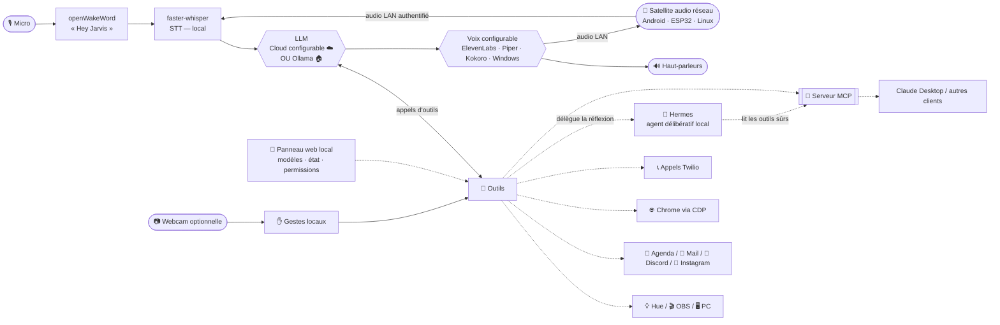

# 🤖 Jarvis — assistant vocal local

*[English version](README.en.md)*


Un assistant vocal en français qui tourne **sur ta machine**. Dis *« Hey Jarvis »*,
parle naturellement : il raisonne avec un LLM, utilise une boîte à outils extensible
(domotique, PC, web, téléphone…) et te répond à voix haute. Trois modes distincts :
**hybride** (IA cloud quotidienne + Hermes pour le fond), **qualité** (modèle cloud
le plus puissant configuré) ou **100 % local hors ligne** (Ollama + voix locale).
Le LLM et la voix se choisissent séparément. **OpenAI et Claude/Anthropic sont
intégrés aujourd'hui** ; d'autres fournisseurs, comme Gemini, peuvent être ajoutés
par connecteur sans changer ces trois modes.

**🧠 Jarvis + Hermes.** Pour la réflexion de fond et la recherche, Jarvis **délègue à
[Hermes](docs/hermes.md)**, un agent délibératif qui tourne **en local** (conteneur
Docker, recommandé dans une VM Ubuntu isolée). La doctrine est nette : **Hermes orchestre et pense ; Jarvis détient les clés
et le corps** — c'est toujours Jarvis qui exécute les actions, jamais Hermes, et
**aucun identifiant ne vit dans l'environnement d'Hermes** (il lit le Vault et les
outils sûrs, écrit seulement des brouillons).

**📡 Jarvis dans chaque pièce.** Ajoute un ou plusieurs **satellites audio réseau**
pour déporter le micro et le haut-parleur dans la cuisine, le salon ou une autre
pièce. Le PC reste le cerveau central ; aucun long câble ne le relie aux pièces.
Le client disponible aujourd'hui cible Raspberry Pi/Linux, mais le protocole est
prévu pour accueillir des solutions moins chères : ancien téléphone Android,
ESP32 avec audio ou Pi Zero ([options et fonctionnement](docs/satellite.md) ·
[guide de choix et d'installation](docs/satellite_installation.md) ·
[installation Raspberry/Linux détaillée](docs/satellite_pi.md)).

**🖥️ Serveur sans écran + poste principal.** Jarvis peut tourner 24 h/24 sur un
ancien PC sans écran, tandis qu'un agent Windows authentifié déporte le micro, le
son, les applications, Chrome, OBS, la webcam, les gestes et le contrôle Astra vers
le PC utilisé au quotidien ([guide complet](docs/poste_principal_windows.md)).

> **Pas de deuxième ordinateur ?** Un seul PC reste la solution la plus simple.
> Pour du H24, le cerveau peut aussi être placé sur un NAS, un mini-PC ou un VPS,
> avec les limites de chaque option dans le
> [comparatif des hébergements H24](docs/hebergement_h24.md).

> Projet perso partagé tel quel. Cible **Windows 11**, nécessite un micro et (en mode
> cloud) une clé API du fournisseur choisi. Les abonnements grand public et les API
> sont généralement séparés. La plupart des intégrations sont **optionnelles** et se
> désactivent proprement si non configurées.

## ✨ Fonctionnalités

- 🎙️ **Tout à la voix** — mot d'activation (openWakeWord), transcription locale (Whisper), réponses parlées
- 👁️ **Vision de l'écran** — « c'est quoi cette erreur ? », « lis ça », « traduis » (capture → LLM)
- 💡 **Domotique** — Philips Hue (allumer, luminosité, couleur), ambiances/scènes
- 🎬 **Streaming** — contrôle d'OBS (direct, enregistrement, scènes, replay)
- 🖥️ **Contrôle PC** — lancer des apps, média/volume, stats GPU/CPU/RAM en direct
- 🧩 **Corps Windows déporté** — ancien PC serveur sans écran, nouveau PC principal pour l'audio, l'écran, Astra, Chrome, OBS et les gestes ([installation](docs/poste_principal_windows.md))
- 📅 **Agenda** — Google Agenda sur **tous** tes agendas (y compris abonnés iCal), création/suppression avec confirmation
- 📧 **Mail** — résumés Gmail et rédaction
- 💬 **Discord** — mentions + récap des messages du jour
- 📸 **Instagram** — abonnés & vues des vidéos vs la veille (multi-comptes)
- 🍽️ **Réservations web** — réserve resto/rendez-vous via un vrai navigateur (Playwright)
- 🌐 **Assistant navigateur** — résume/traduit l'onglet actif, gère les onglets, agit sur les pages (ton vrai Chrome)
- 📞 **Appels téléphoniques** — Twilio : jouer un message, ou une vraie conversation temps réel
- 🧠 **Mémoire long terme** — retient tes préférences, tes proches, tes projets
- 📱 **Pont iPhone** — envoie idées/notes et commandes depuis l'app Raccourcis (Siri comme télécommande à distance)
- 🎭 **Personnalités** — majordome sarcastique, neutre, concis — changeable à la voix
- 🏠 **Présence** — ping ton téléphone, déclenche des scènes quand tu pars/reviens
- 🚀 **Démarrage & scènes automatiques** — lance Jarvis et sa chaîne locale à l'ouverture de session, joue un brief météo/agenda au premier démarrage de la journée et prépare une extinction propre
- 🌤️ **Utilitaires** — météo, minuteurs, heure/date
- 🔌 **Serveur MCP** — expose les outils domotique/PC à tout client MCP (Claude Desktop, Hermes…)
- 🎬 **Hub de contenu** — vault d'inspirations Insta/TikTok (télécharge, transcrit, indexe), idées & scripts générés, ingestion YouTube ([docs/hub_contenu.md](docs/hub_contenu.md))
- 🗂️ **Suivi de contenus** — pipeline vidéo *idée → script → tournage → montage → publié*, croisé avec ton agenda ; « où j'en suis ? » ([docs/suivi_contenu.md](docs/suivi_contenu.md))
- 🤝 **Délégation à Hermes** — confie la réflexion / recherche de fond à un agent délibératif **local** (doctrine : Jarvis tient les clés & le corps, Hermes pense) ([fonctionnement](docs/hermes.md) · [serveur Ubuntu/Hyper-V](docs/hermes_server_vm.md))
- 🧭 **HUD & panneau web local** (`/panneau`) — commandes rapides de modèle/voix, état de la chaîne, réglages et permissions — **accessibles en local uniquement** ([docs/panneau.md](docs/panneau.md))
- 🔐 **Sécurité graduée** — niveaux **N1/N2/N3** par outil, « toujours autoriser » révocable, budget LLM par fournisseur
- 💸 **Routage & budgets** — 3 modes (local / hybride / qualité), fournisseur cloud et voix configurables séparément, suivi des coûts et **bascule auto en local** au plafond ([docs/costs.md](docs/costs.md))
- 📊 **Cockpit personnel local** — abonnements, échéances, détection par reçus Gmail et import CSV de transactions ; les données financières restent gitignorées et ne sont jamais exposées à Hermes/MCP ([docs/cockpit.md](docs/cockpit.md))
- ⏻ **Extinction / réveil du PC** — extinction propre à la voix (confirmation N3, délai annulable) ; méthodes génériques de réveil documentées selon le matériel ([docs/wol.md](docs/wol.md))
- ✋ **Contrôle optionnel par caméra et gestes** — avec une webcam configurée, les modes **Fenêtres** (changer/défiler) et **Audio** (volume/pistes) complètent les actions lumière/média/OBS ; traitement **100 % local**, aucune image ne sort ([docs/gestes.md](docs/gestes.md))
- 📡 **Satellites multi-pièces** — déporte micro et haut-parleur sur un client réseau ; Raspberry/Linux est disponible, le Pi Zero 2 W est expérimental, et Android/ESP32 audio restent des cibles à développer. Wake word local, LAN authentifié, contexte de la pièce et confirmations vocales sensibles ([installation et choix du matériel](docs/satellite_installation.md) · [protocole](docs/satellite.md))
- 🗞️ **Signal Matin** — compose un quotidien personnel A4 monochrome à partir d’un JSON validé : briefing, actualités sourcées, agenda, priorités et veille. Preview HTML, PDF Playwright, densité adaptative et deux automatismes d'impression au choix : heure fixe sur une machine disponible 24 h/24, ou premier brief quotidien au démarrage du PC, sans doublon lors des relances ([guide](docs/signal_matin.md) · [design system](docs/signal_matin_design.md))
- 🎵 **Reconnaissance musicale** — « c'est quoi cette musique ? » (micro de la pièce **ou** son d'une vidéo/reel via loopback), à la demande uniquement ([docs/musique.md](docs/musique.md))
- 🪟 **Overlay de réponses** — mini-fenêtre flottante qui affiche à l'écrit ce que Jarvis dit, sans jamais voler le focus (topmost, clic-transparent, invisible en stream), 2e écran configurable + mode silencieux visuel ([docs/overlay.md](docs/overlay.md))
- 🏠 **Google Home / Nest** — *(⚠️ expérimental)* liste des appareils Nest + état ([docs/google_home.md](docs/google_home.md))
- 🔵 **Alexa / Echo** — *(via API non officielle)* annonces/TTS, média, et contrôle d'appareils via Routines (« allume la clim », « éteins la télé ») ([docs/alexa.md](docs/alexa.md))

## 🎬 Démo

> 📺 *Vidéo / GIF de démo à venir — placeholder.*

## 🏗️ Architecture



> **Jarvis tient les clés & le corps** (il exécute) ; **Hermes pense** (réflexion, recherche,
> analyse du Vault). Hermes ne voit que les **outils sûrs** exposés par le serveur MCP de Jarvis.

## 🎚️ Les trois modes

| Mode | LLM | Voix | Usage |
|---|---|---|---|
| **hybride** *(défaut)* | modèle quotidien économique du fournisseur choisi — Luna pour OpenAI, Haiku pour Claude par défaut | moteur choisi séparément | demandes courtes en cloud, tâches de fond confiées à Hermes |
| **qualité** | profil le plus puissant du même fournisseur | moteur choisi séparément | demandes exigeantes et raisonnement renforcé |
| **local** | Ollama (`qwen3.5:4b`…) | Piper, Kokoro ou Windows | **100 % hors ligne**, aucune API et aucun coût d'usage |

La transcription faster-whisper reste locale dans les trois modes.

> **Petit budget cloud ?** Le mode local est disponible aujourd'hui sans coût
> d'API. Des connecteurs optionnels **Gemini (niveau gratuit)** et **DeepSeek
> (paiement à l'usage économique)** sont proposés dans la roadmap, mais ne sont
> pas encore intégrés. Le projet, les limites et les précautions de confidentialité
> sont détaillés dans [le guide des coûts](docs/costs.md#proposition-pour-les-petits-budgets-cloud-roadmap).

Bascule en une ligne : `mode: local`, `hybride` (défaut) ou `qualite` — ou à la voix « passe en local ». Voir [docs/local.md](docs/local.md) et [docs/costs.md](docs/costs.md)
pour le bilan honnête de fiabilité (un modèle 7B gère bien les outils domotique/PC ;
les **features à vision comme le navigateur & les réservations restent cloud recommandé**).

**Matériel local (honnête) :** Whisper `medium` ≈ 2–3 Go VRAM, `qwen3.5:4b` (Q4) ≈ 3 Go —
une carte **6 Go** (RTX 2060/3060) fait tourner les deux confortablement. Le `qwen3.5:9b`
(~6 Go) demande plus de marge. Piper est temps réel sur CPU. `python scripts/doctor.py`
conseille le modèle selon ta VRAM.

## 🚀 Installation Windows en un clic

Sur **Windows 11**, télécharge le dépôt puis double-clique sur
**`INSTALLER_JARVIS.bat`**. Il installe [uv](https://docs.astral.sh/uv/) et Git avec
`winget` s'ils manquent, puis Python 3.13 et les dépendances aux versions exactes de
`uv.lock`, Chromium, et lance l'assistant de configuration (`scripts/setup.py`). Ton
`config.yaml` existant est conservé. Ensuite, lance Jarvis avec **`lancer_jarvis.bat`**.
Sur un PC à processeur ARM (Snapdragon), Whisper local n'existe pas : Jarvis
transcrit alors la voix avec OpenAI (clé `openai.cle`, jamais en mode local), et la
voix Piper comme la recherche DuckDuckGo y sont indisponibles
([#14](https://github.com/sosoj92/jarvis-assistant-vocal/issues/14)).

## 🚀 Démarrage rapide (installation manuelle)

Prérequis : **Python 3.13**, [uv](https://docs.astral.sh/uv/), Windows 11, un micro.

```bash
uv sync
uv run playwright install chromium        # pour les réservations / le navigateur
copy config.example.yaml config.yaml      # puis remplis ce dont tu as besoin
uv run python jarvis14.py
```

Dis **« Hey Jarvis »**. Il faut soit la clé API du fournisseur cloud sélectionné
(`openai.cle` ou `anthropic.cle`), soit un modèle Ollama en mode local. Tout le reste
est optionnel.

Débutant complet ? Vois **[INSTALL_WITH_AI.md](INSTALL_WITH_AI.md)** — à coller dans
n'importe quelle IA gratuite, elle t'installe tout pas à pas. Ou lance l'installateur
interactif : `python scripts/setup.py`. Un souci ? `python scripts/doctor.py` diagnostique.

## 🤝 Se faire aider par une IA (gratuitement)

**Pour INSTALLER** (aucune connaissance requise) — l'option zéro friction : ouvre
n'importe quel chatbot gratuit ([Claude.ai](https://claude.ai),
[ChatGPT](https://chat.openai.com), [Gemini](https://gemini.google.com)), colle le
contenu de **[INSTALL_WITH_AI.md](INSTALL_WITH_AI.md)**, et laisse-toi guider.

**Pour MODIFIER / bidouiller le code**, plusieurs options gratuites :

- 🏠 **Cline ou Aider + Ollama** — un assistant de code **100 % local et gratuit**, dans
  l'esprit du projet. Le must si tu veux rester hors ligne.
- **Gemini CLI** — gratuit, limites généreuses, agentique dans le terminal.
- **GitHub Copilot Free** — niveau gratuit dans VS Code.
- **Cursor** (offre gratuite) — pratique pour découvrir, mais limité.
- **Claude Code** — si tu l'as (c'est ce qui a construit ce projet).

Aucun outil n'est imposé : prends celui qui te convient.

## ⚙️ Configuration

Tout est dans un unique `config.yaml` **non versionné** (copié depuis
`config.example.yaml`, qui documente chaque clé). Nouvelles sections côté config :
`cloud`/`openai`/`anthropic` (LLM cloud), `tts`/`elevenlabs` (voix), `hermes` (délégation), `integrations`/`hub` (Vault + génération), `suivi` (pipeline
de contenus), `securite.toujours` (autorisations N2 mémorisées), `budget.prix`
(coût LLM), `serveur`/`pont_iphone`. Guides par intégration :

| Intégration | Guide |
|---|---|
| Fournisseurs cloud (OpenAI / Claude) | [docs/openai.md](docs/openai.md) |
| Modes local / hybride / qualité | [docs/local.md](docs/local.md) |
| Routage 3 modes, coûts & budgets | [docs/costs.md](docs/costs.md) |
| Philips Hue | [docs/hue.md](docs/hue.md) |
| OBS | [docs/obs.md](docs/obs.md) |
| Google Agenda + iCal | [docs/agenda.md](docs/agenda.md) |
| Détection de présence | [docs/presence.md](docs/presence.md) |
| Bot Discord | [docs/discord.md](docs/discord.md) |
| Appels Twilio | [docs/appels.md](docs/appels.md) |
| Navigateur (Chrome CDP) | [docs/navigateur.md](docs/navigateur.md) |
| Réservations web | [docs/reservation.md](docs/reservation.md) |
| Instagram | [docs/instagram.md](docs/instagram.md) |
| Serveur MCP | [docs/mcp.md](docs/mcp.md) |
| Pont iPhone (Raccourcis) | [docs/iphone.md](docs/iphone.md) |
| **Hermes (délégation, cloisonnement)** | [docs/hermes.md](docs/hermes.md) |
| **Hub de contenu (Vault + génération)** | [docs/hub_contenu.md](docs/hub_contenu.md) |
| **Suivi de contenus** | [docs/suivi_contenu.md](docs/suivi_contenu.md) |
| **Panneau web (modèles · état · permissions)** | [docs/panneau.md](docs/panneau.md) |
| **Extinction / Wake-on-LAN** | [docs/wol.md](docs/wol.md) |
| **Gestes de la main (webcam)** | [docs/gestes.md](docs/gestes.md) |
| **Satellites audio multi-pièces** | [installation et matériel](docs/satellite_installation.md) · [protocole](docs/satellite.md) · [Raspberry/Linux détaillé](docs/satellite_pi.md) |
| **Ancien PC serveur + nouveau PC principal** | [docs/poste_principal_windows.md](docs/poste_principal_windows.md) |
| **H24 sans deuxième PC : PC unique, NAS, mini-PC ou VPS** | [docs/hebergement_h24.md](docs/hebergement_h24.md) |
| **Reconnaissance musicale (Shazam-like)** | [docs/musique.md](docs/musique.md) |
| **Spotify (playlist des musiques reconnues)** | [docs/spotify.md](docs/spotify.md) |
| **Cockpit (tableau de bord perso, local)** | [docs/cockpit.md](docs/cockpit.md) |
| **Overlay de réponses (fenêtre flottante)** | [docs/overlay.md](docs/overlay.md) |
| **Google Home / Nest** *(⚠️ expérimental)* | [docs/google_home.md](docs/google_home.md) |
| **Alexa / Echo** *(via API non officielle)* | [docs/alexa.md](docs/alexa.md) |
| **Latence perçue (UX)** | [docs/latency.md](docs/latency.md) |

## 🛡️ Éthique & Sécurité

La confiance est intégrée, pas rajoutée :

- **Confirmation vocale** avant toute action irréversible (envoi de mail, réservation, suppression, appel…).
- **Les appels se présentent** honnêtement : *« Bonjour, je suis l'assistant vocal automatisé de [prénom]… »* — jamais en se faisant passer pour un humain.
- **Jamais** de mot de passe ni de données bancaires saisis, jamais de paiement automatique.
- **Domaines protégés** (banque, impôts, santé) sur ton vrai navigateur = **lecture seule**.
- **Secrets & données perso jamais versionnés** (`config.yaml`, mémoire, logs, transcriptions d'appels, tokens OAuth — tous gitignorés).
- Au téléphone, Jarvis ne confirme que ce que tu as validé **avant** l'appel.
- **Niveaux de permission N1/N2/N3** : chaque outil a un niveau — **N1** sûr (auto, local + iPhone), **N2** sensible (confirmation ; « toujours autoriser » révocable), **N3** critique (confirmation à chaque fois, jamais mémorisable, **jamais à distance**). Extinction du PC, mails, appels, réservations = N3.
- **Pont iPhone** : à distance, seuls les outils **sûrs (N1)** s'exécutent ; toute action sensible est refusée (« à faire à la voix à la maison »). Un token volé ne peut qu'allumer/éteindre des lumières.
- **Cloisonnement Hermes** : Hermes lit le Vault et les outils **en lecture seule**, écrit uniquement des brouillons — **aucun credential** dans son environnement.

## 🗺️ Roadmap

- [x] **Délégation à Hermes** (agent délibératif local) + gateway Telegram (whitelist stricte)
- [x] **Hub de contenu** : Vault d'inspirations + génération d'idées/scripts + ingestion YouTube
- [x] **Suivi de contenus** : pipeline idée → publié, croisé avec l'agenda
- [x] **Panneau web local** : modèles · état de la chaîne · permissions **N1/N2/N3** · budget LLM
- [x] **Démarrage automatique & scènes** : chaîne Jarvis/Hermes, brief quotidien météo/agenda et scène d'extinction
- [x] **Extinction propre du PC** (N3, délai annulable) — options de réveil documentées séparément selon le matériel
- [x] **Contrôle caméra/gestes v2** : modes Fenêtres et Audio, calibration locale et garde-fous anti-faux-positifs
- [x] **Cockpit local — phase 1** : abonnements, détection par mail et transactions CSV
- [x] **Client satellite Raspberry Pi/Linux** : audio, wake word, protocole LAN sécurisé et multi-pièces — matériel audio choisi librement par chaque installation
- [ ] **Clients satellites économiques** : ancien téléphone Android et ESP32 audio, sur le même protocole sans déplacer le cerveau hors du PC
- [ ] **Connecteurs cloud économiques optionnels** : Gemini (niveau gratuit) et DeepSeek, avec appels d'outils testés, suivi des coûts et repli local sur quota épuisé
- [ ] Contrôle des lampes vidéo Godox (aujourd'hui Hue seulement)
- [x] Notes / idées (+ pont iPhone via Raccourcis) — rappels programmés à venir
- [ ] Adaptateur générique de réveil/alimentation avec vérification d'état robuste
- [ ] TTS en streaming phrase par phrase (voir [docs/latency.md](docs/latency.md))
- [ ] Boucle navigateur en 100 % local : la vision de `qwen3.5` lit déjà le texte des boutons (testé) — reste à valider le pilotage complet
- [ ] Rafraîchissement auto des tokens Instagram entre redémarrages (partiel aujourd'hui)

## 🤝 Contribuer

Ajouter un outil = un seul fichier dans `tools/` avec un décorateur `@outil(...)` — il
est auto-découvert, aucun câblage. Issues et PR bienvenues. Merci de ne jamais committer
de vrais secrets (vois `.gitignore`).

## 🧑‍💼 Assistant personnel : salutation, voix, modes, routines

### Salutation après « Hey Jarvis »
Dire « Hey Jarvis » déclenche une salutation courte **sans appel au LLM** : « Bonjour Wafo Arold. », « Bonsoir Wafo Arold, je vous écoute. », « Ravi de vous revoir, Wafo Arold. » (après une absence). Bonjour jusqu'à 18 h, Bonsoir ensuite ; plus sobre en modes nuit/travail/gaming/ne pas déranger. Après la salutation, Jarvis attend ~0,4 s et vide le tampon micro pour **ne pas se réentendre**. Les salutations déjà synthétisées sont gardées en mémoire (instantanées dès la 2ᵉ fois ; la 1ʳᵉ dépend du moteur TTS). Réglages : bloc `accueil:` et `assistant.nom_utilisateur`. Pour parler dès le réveil, attendez la fin de la salutation.

### Voix naturelle (nettoyage du texte avant le TTS)
`core/voix_naturelle.py` crée une **version vocale** du texte : Markdown, emojis, URLs, balises, tableaux et symboles retirés ; « 24 °C » → « 24 degrés », « 72 % » → « 72 pour cent », « 250 Mo » → « 250 mégaoctets », « 14h30 » → « 14 heures 30 », « 05/03/2025 » → « 5 mars 2025 », « 3.14 » → « 3 virgule 14 », e-mails dits « x arobase y point com ». Le texte affiché (HUD, overlay) **n'est pas modifié**. Limite : le texte est nettoyé phrase par phrase ; un bloc de code étalé sur plusieurs phrases lues en flux peut être mal regroupé.

### Voix
- « Quelles voix sont disponibles ? » · « Utilise la voix féminine / masculine / française / anglaise / *nom* » · « Reviens à la voix précédente ».
- Sources : profils de `tts.profils` (config.yaml, **aucun identifiant n'est inventé**), voix Windows installées (détectées), voix du compte ElevenLabs (si clé valide).
- Le choix est mémorisé (`notes/.voix_profil.json`). Un mode peut avoir sa voix : `modes_usage.nuit.voix: douce`.
- Limite : la vitesse de voix s'applique à Windows et Kokoro (pas à ElevenLabs/Piper).

### Modes : Normal · Travail · Gaming · Nuit · Ne pas déranger
Commandes : « Active le mode nuit », « Désactive le mode nuit », « Passe en mode gaming », « Active le mode travail », « Active le mode ne pas déranger », « Retour au mode normal », « Quel mode ? ». Compris **sans LLM**, mémorisés dans `notes/.mode_usage.json`.

| Mode | Volume | Voix | Réponses | Annonces spontanées | HUD |
|---|---|---|---|---|---|
| Normal | 100 % | normale | normales | toutes | normal |
| Travail | 100 % | normale | brèves, ton pro | importantes | normal |
| Gaming | 100 % (voix un peu plus rapide) | normale | très courtes | importantes | discret |
| Nuit | 50 % | plus lente, voix `nuit` si définie | très courtes | importantes | discret |
| Ne pas déranger | 100 % | normale | brèves | **aucune** (sauf minuteurs/alarmes) | discret |

Mode nuit automatique : `mode_nuit.auto: true` + `heure_debut`/`heure_fin` (ex. 23:00 → 07:00). « Désactive le mode nuit » pendant la plage le coupe jusqu'à la fin de celle-ci. « Active/Désactive la proactivité » force les annonces spontanées on/off. Les appels `voix.parler(texte, importance=...)` (`info`, `normal`, `important`, `critique`) respectent le mode ; sans précision, un message reste `critique` (donc jamais supprimé).

### Contexte, corrections, commandes multiples
Jarvis garde **en mémoire vive seulement** (jamais sur disque) les 3 dernières actions d'outils pendant 10 min et les donne au LLM : « Ouvre Chrome » puis « Non, Firefox », « Monte le volume à 50 » puis « Finalement 30 », « Et après-demain ? ». Les commandes multiples (« ouvre Chrome, lance YouTube et mets le volume à 30 % ») sont traitées par le LLM avec tous les outils d'un coup ; les commandes simples reçoivent une réponse de 3 à 6 mots (« Chrome est ouvert. »). Ces comportements reposent sur la consigne donnée au LLM : leur fiabilité dépend du modèle Mistral choisi. La mémoire long terme (`memory.json`) n'est pas modifiée.

### Confirmations, erreurs, HUD
Le système N2/N3 existant est conservé : seules les actions sensibles demandent confirmation ; « Oui », « Non », « Annule » sont compris. Les erreurs d'outils deviennent des phrases humaines (« Je n'ai pas trouvé ce fichier. », « Le service est temporairement indisponible. Je peux réessayer. ») ; le détail reste dans `logs/`. Le HUD affiche : VEILLE, ECOUTE…, REFLEXION…, EXECUTION…, REPONSE…, ERREUR (+ MICRO COUPE) et s'estompe en modes discrets.

### Routines
Dans `config.yaml`, bloc `routines:` (voir `config.example.yaml`) : « Jarvis, commence ma journée » peut activer le mode travail, ouvrir des applications et dire une phrase. Une routine **n'exécute jamais** un outil soumis à confirmation. Elle complète les scènes existantes (`scenes.example.yaml`).

### Android : ce qui est réaliste
Le projet Windows ne devient pas une appli Android. En revanche Jarvis a déjà de quoi accueillir un téléphone **sans refonte** :
1. **Satellite** (`core/satellite.py`) : WebSocket `/satellite` + token, audio PCM 16 kHz vers le PC, réponses audio + état (`ecoute|reflexion|parole…`) + texte en retour. Une appli Android peut jouer exactement le rôle du Raspberry Pi : micro du téléphone, haut-parleur, affichage de l'état et du texte.
2. **Pont HTTP** (`core/pont_iphone.py`, `/api/inbox`, en-tête `x-jarvis-token`) : envoi de commandes texte depuis n'importe quel client (Tasker, HTTP Shortcuts, PWA).
3. **Serveur unifié** (`core/serveur.py`) prévu pour monter des PWA : un tableau de bord web (HUD, choix de voix, modes) accessible depuis le téléphone est l'étape la plus simple.

Architecture recommandée : `Android (PWA ou appli) → Wi-Fi local ou tunnel → serveur Jarvis Windows (token obligatoire, connexions non autorisées refusées) → Mistral / outils / TTS`. Étapes : (a) PWA de commande + état + modes via le serveur unifié ; (b) appli Android « satellite » avec le protocole existant pour servir de micro ; (c) notifications. **Non implémenté ici** : aucune appli Android n'est livrée ; les routes HTTP de pilotage des modes/voix pour mobile restent à ajouter. Sécurité : token secret long, réseau local de préférence, pas d'exposition Internet sans tunnel authentifié.

### Contrôle du PC (clic, clavier, applications, Chrome)
**Pourquoi Jarvis ne pouvait pas agir** : (1) une phrase avec « Spotify » ne lui donnait que les outils musique ; (2) `ministral`/`nemo` ne voient pas les images, donc pas de clic « à l'œil » ; (3) aucun outil ne tapait au clavier ou ne cliquait un bouton par son nom ; (4) la connexion à Chrome n'attendait que 8 s et masquait l'erreur. Corrigé :

| Tu dis | Outil |
|---|---|
| « Ouvre Spotify / Discord / VS Code » (toute appli installée, Store compris) | `lancer_application_pc` |
| « Passe sur Spotify » | `activer_fenetre` (par titre **ou programme**) |
| « Cherche Daft Punk sur Spotify » (appli de bureau) | `rechercher_dans_application` (ouvre, Ctrl+L, tape, Entrée) |
| « Cherche Daft Punk sur YouTube/Spotify » (web) | `browser_open` → résultats directs |
| « Appuie sur Ctrl+S », « Entrée », « Alt+Tab » | `appuyer_touches` |
| « Écris bonjour » | `taper_texte` (accents compris) |
| « Clique sur Enregistrer » (par son nom, sans vision) | `cliquer_bouton` / `lister_controles` |
| « Clique sur ce bouton » (à l'œil) | `capture_screen` + `cliquer_ecran` avec un modèle de vision Mistral (`mistral.modele_vision`, défaut `pixtral-12b-latest`, secours `mistral-small-latest`) |

**Commandes PC comprises SANS LLM** (instantanées, fiables, même avec un petit modèle) : « Ouvre mon navigateur / Chrome / Spotify / Steam » · « Clique », « Double clic », « Clic droit » (là où est la souris) · « Clique sur *Enregistrer* » (par son nom ; sinon repli par vision) · « Descends / Remonte la page », « Tout en bas » · « Déplace la souris vers la droite de 300 » · « Appuie sur Ctrl S / Entrée / Alt Tab » · « Tape *texte* » / « Écris *texte* » · « Passe sur *Spotify* » · « Cherche *X* sur Spotify / YouTube / Amazon / Google » · « Ferme la fenêtre », « Nouvel onglet », « Actualise la page », « Minimise / Maximise », « Montre le bureau », « Copie », « Colle », « Enregistre », « Verrouille le PC » · **plusieurs actions d'un coup** : « Ouvre Chrome et lance YouTube », « Ouvre le bloc-notes puis tape bonjour puis appuie sur Ctrl S » (exécutées dans l'ordre ; si une étape n'est pas comprise, tout part au LLM, rien n'est fait à moitié ; jamais d'outil à confirmation dans une chaîne). Tout ce qui n'est pas reconnu continue d'aller au LLM comme avant. Sécurité : jamais de clic aveugle sur supprimer / payer / acheter / envoyer / mot de passe.

**Diagnostic** : `uv run python scripts/diagnostic_pc.py` vérifie sur ta machine fenêtres, menu Démarrer, UI Automation, souris, capture, Chrome, Playwright, vision — sans rien cliquer ni taper — et dit ce qui est en échec.

**Si tu as `navigateur.prefere: "firefox"`** : Firefox ouvre les pages mais ne peut pas être piloté, d'où le message « Chrome + Jarvis ». Avec `piloter_avec_chrome: true` (défaut), Jarvis lance quand même Chrome (profil dédié) dès qu'il doit lire ou cliquer dans une page.

**« Chrome + Jarvis »** : Jarvis pilote les pages web via un Chrome dédié (profil « ChromeJarvis », port de debug), car Chrome interdit le debug sur le profil normal depuis la v136. Il le lance **tout seul** ; le raccourci n'est qu'un secours. Connecte-toi une fois à tes sites dans cette fenêtre. Si ça échoue, le message donne maintenant la cause exacte (Chrome introuvable, Playwright absent, délai dépassé) ; `navigateur.attente_lancement` règle l'attente (30 s).

**Limites réelles** : pas de saisie de mots de passe/paiements ; Ctrl+Alt+Suppr refusé ; une fenêtre lancée « en administrateur » (ou une invite UAC) ignore les clics/touches si Jarvis n'est pas lancé en administrateur ; certains jeux (anti-triche) bloquent la saisie simulée ; `cliquer_bouton` ne voit que les applications exposant UI Automation (Chrome en page web : utilise `browser_interact`). `controle_pc_astra` ne fonctionne qu'avec OpenAI. Les actions de clic/saisie hors navigateur ne demandent pas de confirmation (seuls les outils N2/N3 existants en demandent).
\r\n
### Tests
`python -m unittest tests.test_assistant_personnel` (35 tests, sans micro ni réseau) : wake word, salutation, nettoyage vocal, voix, modes, routines, contexte, erreurs, confirmations.

## 📄 Licence

MIT — voir [LICENSE](LICENSE).
